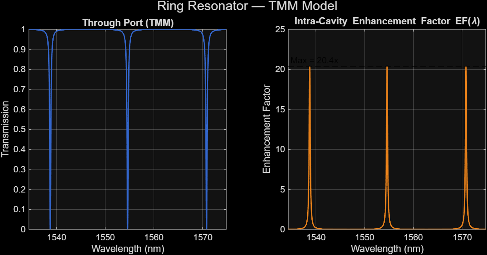
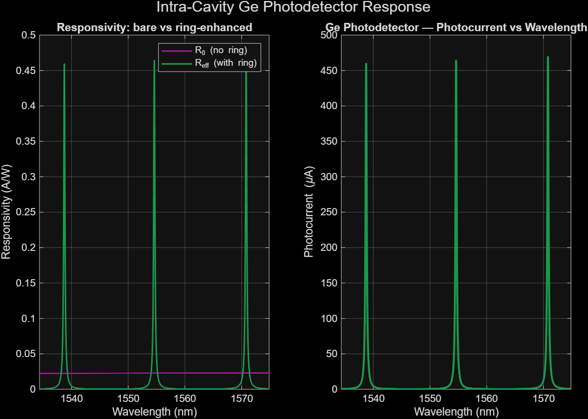
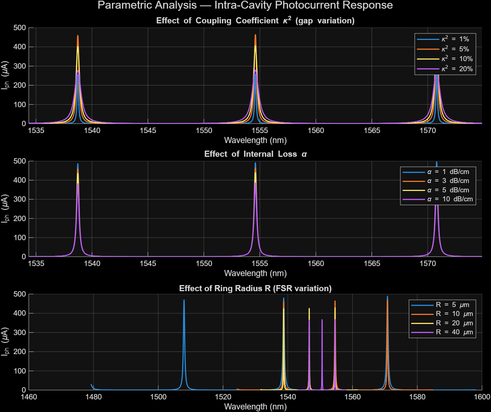

# Silicon Photonics: Microring Resonator Photodetectors

**Photonic Devices — Academic Simulation Project**

**Politecnico di Milano | MATLAB**

## Project Overview

This project investigates the performance of photodetectors integrated with silicon microring resonators, focusing on resonant optical enhancement and photodetection efficiency.

The work examines graphene-based and germanium-based photodetector configurations through numerical modeling and simulation, with particular attention to the influence of resonator parameters on device performance.

## Objectives

- Model optical transmission through a silicon microring resonator.
- Investigate resonant enhancement of optical intensity.
- Analyze photodetector responsivity and output signals.
- Study the effects of coupling strength, propagation loss, and ring radius.
- Compare the behavior of graphene and germanium photodetector architectures.

## Simulation Methodology

The numerical analysis uses MATLAB and a Transfer Matrix Method (TMM)-based resonator model.

The uploaded MATLAB implementation focuses on a germanium photodetector integrated within a silicon microring resonator.

The model evaluates:

- Through-port optical transmission.
- Intracavity enhancement factor.
- Free spectral range and approximate quality factor.
- Germanium detector responsivity.
- Photocurrent as a function of wavelength.

A parametric study examines how the photocurrent response changes with bus-ring coupling, internal propagation loss, and resonator radius.

## System Configuration

The MATLAB script uses the following baseline parameters:

| Parameter | Value |
|---|---|
| Target wavelength | 1550 nm |
| Ring radius | 10 µm |
| Effective refractive index | 2.4 |
| Group refractive index | 3.8 |
| Waveguide propagation loss | 3 dB/cm |
| Germanium absorber length | 5 µm |
| Bus-ring power coupling coefficient | 5% |
| Input optical power | 1 mW |
| External quantum efficiency | 80% |

These values describe the baseline MATLAB configuration. The accompanying report also discusses other configurations, including a 40 µm ring radius.

## Simulation Outputs

### 1. Ring Resonator Transmission and Optical Enhancement

The through-port transmission exhibits resonance dips, while the intracavity enhancement factor reaches approximately **20.4×** for the simulated configuration. This represents optical power enhancement inside the resonator, not an experimentally measured detector gain.

### 2. Germanium Photodetector Response

The simulated ring-enhanced responsivity exhibits peaks at the resonance wavelengths. The corresponding photocurrent reaches approximately **460–470 µA** for the modeled 1 mW optical input.

### 3. Parametric Analysis

The parameter sweeps investigate the effects of bus-ring coupling, propagation loss, and ring radius. Coupling and loss influence the resonance response, while changing the ring radius alters the free spectral range and the spectral positions of the resonances.

All figures are numerical simulation outputs generated using MATLAB.

## Results and Discussion

The project report discusses resonant enhancement in graphene and germanium photodetectors.

Under the modeled conditions, the report presents enhancement factors of approximately 10× for the graphene configuration and 10.5× for the germanium configuration.

These values are numerical simulation results, not independently measured device performance.

The study illustrates the importance of optical resonance, coupling conditions, and device losses in determining the response of integrated photodetectors.

## Tools and Technical Skills

- MATLAB
- Numerical modeling
- Transfer Matrix Method
- Silicon photonics
- Microring resonators
- Optical transmission analysis
- Photodetector responsivity
- Parametric simulation and data visualization

## Repository Contents

- `lastSimulations.m` — MATLAB simulation of the germanium photodetector and microring resonator.
- `Photonic_Devices_Project_Report.pdf` — Academic project report covering the simulation study and analysis.

## Scientific Reference

Schuler, S., et al. (2021). *High-responsivity graphene photodetectors integrated on silicon microring resonators.* Nature Communications, 12, 3733.

https://doi.org/10.1038/s41467-021-23436-x

The referenced article provides scientific background for the study. The simulations and academic report in this repository are coursework and should not be confused with the original authors' experimental research.

---

**Project type:** Collaborative academic coursework  
**Field:** Photonic Devices and Optical Communications
